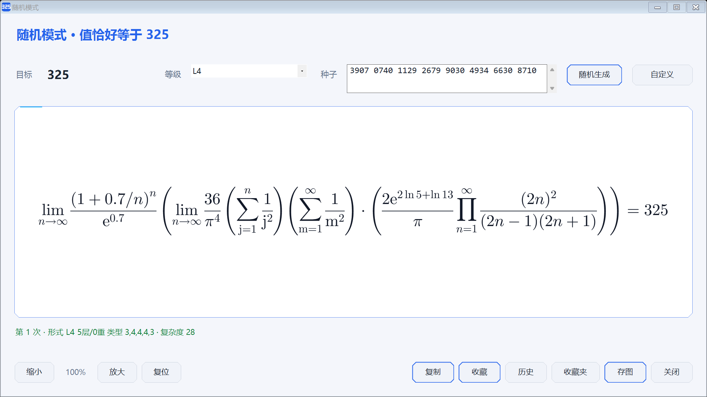

# Calculate325

输入一个目标数字，程序给出等于它的算式。


## 求解

默认自带四个数字串

**325**  

**799** 

**325799** 

**114514**

选一个数字串，用它的数字做四则运算凑出目标值。例如用 `325` 凑 1000：

```
325 × 3 + 25 = 1000
```
可以自定义数字串

数字串自定义范围：0<x<100000000

## 随机生成

随机生成种子，由种子映射为式子，化简后恰好等于 **325**。

主要由较为简单/经典的积分，极限，级数等内容构成




## 其它功能

1.支持Zc编码

2.支持保存图片

3.支持复制LaTeX

4.可以收藏喜欢的表达式

5.有三种皮肤

6.随机模式支持查看历史生成记录


## 含AI生成内容
多数内容由DSH生成，请谨慎查看
